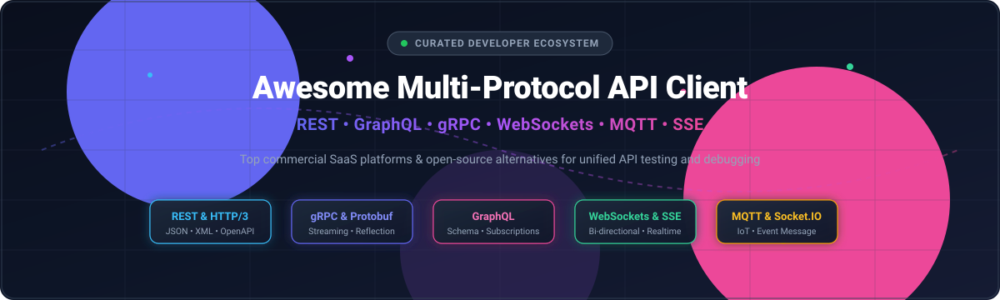

  

# 🌐 Awesome Multi-Protocol API Client (gRPC / WebSockets / REST / GraphQL)

> 🚀 A comprehensive, curated directory of the best **Multi-Protocol API Client** platforms, tools, and developer environments. Compare leading SaaS commercial solutions alongside top open-source alternatives for authoring, testing, debugging, and mocking **REST**, **gRPC**, **WebSockets**, **GraphQL**, **SSE**, and **MQTT** APIs from a single unified interface.
> 
> 🌟 *Star this repository to keep track of new releases and emerging tools!* 🌟

---

## 📑 Table of Contents

- [📈 Sector Overview & Market Dynamics](#-sector-overview--market-dynamics)
- [📋 Quick Comparison Table (SaaS vs OSS)](#-quick-comparison-table)
- [🟦 SaaS / Commercial Hosted Platforms](#-saas--commercial-hosted-platforms)
- [🟩 Open-Source Software Tools](#-open-source-software-tools)
  - [1. Hoppscotch](#1-hoppscotch)
  - [2. Bruno](#2-bruno)
  - [3. Kong Insomnia](#3-kong-insomnia)
  - [4. Yaak](#4-yaak)
  - [5. grpcurl](#5-grpcurl)
  - [6. BloomRPC](#6-bloomrpc)
  - [7. grpcui](#7-grpcui)
  - [8. API Dash](#8-api-dash)
  - [9. Restfox](#9-restfox)
  - [10. Step CI](#10-step-ci)
  - [11. Milkman](#11-milkman)
  - [12. Warthog](#12-warthog)
  - [13. OneOpen Postkid](#13-oneopen-postkid)
- [🤝 Contributing](#-contributing)
- [💖 Support](#-support)
- [📈 Star History](#-star-history)
- [📄 License](#-license)

---

## 📈 Sector Overview & Market Dynamics

The global API management and testing tools market is estimated between **$8 billion and $15 billion** (projected to reach over $35 billion by 2032 at an annual CAGR of ~18–22%). 

The ecosystem is **moderately fragmented**: while enterprise incumbents like Postman and Kong command significant developer mindshare, no single vendor maintains a "winner-take-all" monopoly across every protocol. The landscape is split across specialized gRPC debugging utilities, privacy-first local-first desktop apps, Git-native CI/CD tooling, and browser-based real-time clients.

---

## 🟦 SaaS / Commercial Hosted Platforms

Commercial, cloud-hosted, and hybrid multi-protocol API client platforms. The table below is sorted in **descending order by company valuation / scale**:

| Platform | Company Scale / Valuation | Starting Paid Tier Pricing | Free Tier / Trial Limits | Supported Protocols | Key Strengths |
| :--- | :--- | :--- | :--- | :--- | :--- |
| **📮 [Postman](https://www.postman.com/)** | **$5.6B Valuation** *(~$310M+ ARR)* | **$14/user/month** *(Basic, billed annually)* or **$19/mo** monthly | **Free Forever Plan**: Capped at 1 user, 10,000 Postman API calls/month, up to 5 integrations, 3 active collection runners, unlimited mock servers/specs. | REST, GraphQL, gRPC, WebSockets, Socket.IO, MQTT, SSE | Global industry standard with cloud workspaces, team governance, API cataloging, and comprehensive CI/CD integrations. |
| **🌙 [Kong Insomnia](https://insomnia.rest/)** | **$2.0B Parent Valuation** *(Kong: $100M+ ARR)* | **$12/user/month** *(Team, billed annually)* or **$15/mo** monthly | **Free Essentials Plan**: Capped at 1 user for cloud projects (up to 3 users for Git Sync), 1,000 mock server requests/month, local scratchpad mode. | REST, GraphQL, gRPC, WebSockets, SSE | Deep GraphQL schema introspection, local-first option with End-to-End Encryption (E2EE), and native Kong Gateway plugins. |
| **🐕 [Apidog](https://apidog.com/)** | **Privately Held / Bootstrapped** *(Self-funded, 5M+ users)* | **$9/user/month** *(Basic, billed annually)* or **$12/mo** monthly | **Free Forever Plan**: Free for up to 4 team members, up to 5 projects per team, unlimited test runs, and unlimited mock requests. | REST, GraphQL, WebSockets, gRPC, SSE | All-in-one platform unifying automated API testing, interactive visual documentation, smart mocking, and contract validation. |
| **🛡️ [Kreya](https://kreya.app/)** | **Independent Indie Dev** *(Bootstrapped, Solo-entity)* | **$4.17/month** *(Pro, billed annually at $50/yr)* | **Free Forever Plan**: 1 user, unlimited gRPC/REST/GraphQL/WebSockets over HTTP/2 & HTTP/3, local storage only, request history limited to latest request. *(10-day full-feature trial for Pro)* | gRPC, REST, GraphQL, WebSockets, SSE | Privacy-first desktop client with deep native gRPC features, protobuf reflection, client streaming, and Windows named pipes. |

---

## 🟩 Open-Source Software Tools

Community-driven, self-hostable, and offline-first open-source API clients. The table and detailed list below are sorted in **descending order by GitHub stargazers**:

| Tool | GitHub_Stars | License | Primary Tech Stack | REST | gRPC | WebSockets | GraphQL | MQTT | Architecture / Type |
| :--- | :---: | :--- | :--- | :---: | :---: | :---: | :---: | :---: | :--- |
| **[Hoppscotch](#1-hoppscotch)** |  | MIT | TypeScript, Vue.js | ✅ | ❌ | ✅ | ✅ | ✅ | Web / PWA / Desktop / Self-Hostable |
| **[Bruno](#2-bruno)** |  | MIT | JS, Electron | ✅ | ✅ | ✅ | ✅ | ❌ | Git-native Local Desktop App |
| **[Insomnia (Core)](#3-kong-insomnia)** |  | Apache-2.0 | Electron, React | ✅ | ✅ | ✅ | ✅ | ❌ | Desktop App with Cloud/Git Sync |
| **[Yaak](#4-yaak)** |  | MIT (Source) | Tauri, Rust, React | ✅ | ✅ | ✅ | ✅ | ❌ | Ultra-fast Local Desktop Client |
| **[grpcurl](#5-grpcurl)** |  | MIT | Go | ❌ | ✅ | ❌ | ❌ | ❌ | CLI "cURL for gRPC" |
| **[BloomRPC](#6-bloomrpc)** |  | GPL-3.0 | TypeScript, Electron | ❌ | ✅ | ❌ | ❌ | ❌ | GUI Client for gRPC Services |
| **[grpcui](#7-grpcui)** |  | MIT | Go | ❌ | ✅ | ❌ | ❌ | ❌ | Interactive Web UI for gRPC Servers |
| **[API Dash](#8-api-dash)** |  | Apache-2.0 | Dart, Flutter | ✅ | ❌ | ✅ | ❌ | ❌ | Beautiful Cross-Platform Desktop UI |
| **[Restfox](#9-restfox)** |  | MIT | Vue.js | ✅ | ❌ | ✅ | ❌ | ❌ | Lightweight Offline Web & Desktop Client |
| **[Step CI](#10-step-ci)** |  | Apache-2.0 | TypeScript, Node.js | ✅ | ✅ | ✅ | ✅ | ❌ | Declarative Multi-Protocol Automated Testing |
| **[Milkman](#11-milkman)** |  | Apache-2.0 | Java, JavaFX | ✅ | ✅ | ✅ | ✅ | ❌ | Extensible Plugin-based Workbench |
| **[Warthog](#12-warthog)** |  | Apache-2.0 | Go, Wails | ❌ | ✅ | ❌ | ❌ | ❌ | Dedicated Cross-Platform gRPC GUI |
| **[OneOpen Postkid](#13-oneopen-postkid)** |  | Open Source | Python, Flet | ✅ | ❌ | ✅ | ✅ | ✅ | Pure-Python Local-First API Client |

---

### Detailed Profiles

### 1. Hoppscotch
- **GitHub**: 
- **🛠️ Stack:** TypeScript / Vue.js | **📜 License:** MIT
- **📝 Overview:** Hoppscotch is the most popular open-source API request client on GitHub. It features a modern web-first interface alongside desktop packages, a command-line interface, and self-hosted instances. It provides out-of-the-box support for REST, GraphQL, WebSockets, Server-Sent Events (SSE), Socket.IO, and MQTT.
- **🎯 Best for:** Developers who want an instant web-accessible client with broad protocol support including MQTT and Socket.IO.

### 2. Bruno
- **GitHub**: 
- **🛠️ Stack:** JavaScript / Electron | **📜 License:** MIT
- **📝 Overview:** Bruno reimagines API testing with a Git-friendly, offline-first philosophy. Instead of saving data into proprietary clouds, Bruno saves requests in your repository as plain-text files using the `.bru` markup format. Collections can be version-controlled, diffed, and merged using standard Git workflows.
- **🎯 Best for:** Teams requiring pure local privacy and Git collaboration without vendor cloud lock-in.

### 3. Kong Insomnia
- **GitHub**: 
- **🛠️ Stack:** Electron / React | **📜 License:** Apache-2.0
- **📝 Overview:** Insomnia is a widely adopted desktop development client providing robust GraphQL schema autocompletion, REST execution, WebSockets, and gRPC support with reflection. It offers end-to-end encrypted project synchronization and local scratchpad capabilities.
- **🎯 Best for:** Developers needing schema-driven GraphQL workflows coupled with gRPC in an established GUI.

### 4. Yaak
- **GitHub**: 
- **🛠️ Stack:** Tauri / Rust / React | **📜 License:** MIT (Source code) / Commercial (Pre-built Binaries)
- **📝 Overview:** Created by the original author of Insomnia, Yaak is engineered for maximum speed, low memory overhead, and absolute privacy. Built with Rust and Tauri, Yaak operates entirely offline without telemetry or account requirements.
- **🎯 Best for:** Developers seeking an ultra-responsive native desktop client with complete offline privacy.

### 5. grpcurl
- **GitHub**: 
- **🛠️ Stack:** Go | **📜 License:** MIT
- **📝 Overview:** `grpcurl` is the industry-standard command-line tool for interacting with gRPC servers, effectively functioning as cURL for protobuf services. It dynamically inspects servers with reflection and accepts JSON payloads.
- **🎯 Best for:** DevOps engineers, CLI-centric developers, automated shell scripts, and terminal debugging.

### 6. BloomRPC
- **GitHub**: 
- **🛠️ Stack:** TypeScript / Electron | **📜 License:** GPL-3.0
- **📝 Overview:** BloomRPC provided one of the earliest dedicated graphical desktop interfaces for gRPC, offering proto file imports, TLS authentication, and streaming call visualization.
- **🎯 Best for:** Quick visual exploration of local proto files and standalone gRPC calls.

### 7. grpcui
- **GitHub**: 
- **🛠️ Stack:** Go | **📜 License:** MIT
- **📝 Overview:** From the creators of `grpcurl`, `grpcui` spawns an interactive web application that lets developers test gRPC services in a browser via an intuitive form-based interface.
- **🎯 Best for:** Testing gRPC endpoints interactively in a browser without installing dedicated desktop software.

### 8. API Dash
- **GitHub**: 
- **🛠️ Stack:** Dart / Flutter | **📜 License:** Apache-2.0
- **📝 Overview:** API Dash is an open-source, lightweight alternative to Postman built with Flutter. It focuses on clean UI design, fast startup times, offline-first execution, and code generation across various programming languages.
- **🎯 Best for:** Developers who want an aesthetically clean, lightweight desktop API client without Electron bloat.

### 9. Restfox
- **GitHub**: 
- **🛠️ Stack:** Vue.js | **📜 License:** MIT
- **📝 Overview:** Restfox is a minimalist, offline-first HTTP and WebSocket client. It runs in the web browser, as an offline desktop utility, or as an embedded component within web systems.
- **🎯 Best for:** Zero-install browser testing and lightweight HTTP/WebSocket requests.

### 10. Step CI
- **GitHub**: 
- **🛠️ Stack:** TypeScript / Node.js | **📜 License:** Apache-2.0
- **📝 Overview:** Step CI is an open-source framework for declarative multi-protocol API testing and contract monitoring. It supports REST, GraphQL, gRPC, and WebSockets through simple YAML/JSON test definitions that execute in CI/CD pipelines.
- **🎯 Best for:** Automated testing, multi-step API regression workflows, and CI/CD quality gates.

### 11. Milkman
- **GitHub**: 
- **🛠️ Stack:** Java / JavaFX | **📜 License:** Apache-2.0
- **📝 Overview:** Milkman is an extensible workbench crafted for craftspeople. With an architecture inspired by IDEs, it supports plugins for REST, gRPC, WebSockets, JDBC SQL, Cassandra, and message queues.
- **🎯 Best for:** Polyglot developers who want a single workbench for APIs, database queries, and messaging protocols.

### 12. Warthog
- **GitHub**: 
- **🛠️ Stack:** Go / Wails | **📜 License:** Apache-2.0
- **📝 Overview:** Warthog is a cross-platform desktop gRPC client providing server reflection schema inspection, proto parsing, multi-workspace environments, and streaming invocation.
- **🎯 Best for:** Dedicated gRPC developers requiring a fast, lightweight native GUI.

### 13. OneOpen Postkid
- **Package**: 
- **🛠️ Stack:** Python / Flet | **📜 License:** Open Source
- **📝 Overview:** OneOpen Postkid is a local-first, pure-Python desktop API client supporting HTTP, GraphQL, WebSockets, MQTT, and SOAP. It allows developers to author test scripts in native Python.
- **🎯 Best for:** Python developers desiring an extensible, local-first API client scriptable in Python.

---

## 🤝 Contributing

Contributions are warmly welcomed! If you know of an outstanding open-source or multi-protocol API client that should be featured:

1. Fork this repository.
2. Add your tool with a short description, tech stack, license, and GitHub repository link.
3. Submit a pull request!

Please review our community guidelines:
- Multi-protocol capabilities (REST, GraphQL, gRPC, WebSockets, MQTT, etc.).
- Active maintenance (updates within the last 12 months).
- Clear licensing and documentation.

---

## 💖 Support

If you find this repository valuable for your daily development workflow, please consider supporting the project:

- ⭐ **Star this repository** to help other developers discover it!
- 🍴 **Fork and share** with your teammates and community.
- ☕ **Buy a coffee & sponsor ongoing maintenance:**  
  👉 **[Support on GitHub Sponsors](https://github.com/sponsors/ishandutta2007)**

Your support helps keep this curated directory continuously updated and maintained!

---

## 📈 Star History

---

## 📄 License

This collection is distributed under the [CC0 1.0 Universal](LICENSE) (Public Domain Dedication).  
Individual tools and platforms maintain their respective licenses and terms of service.
